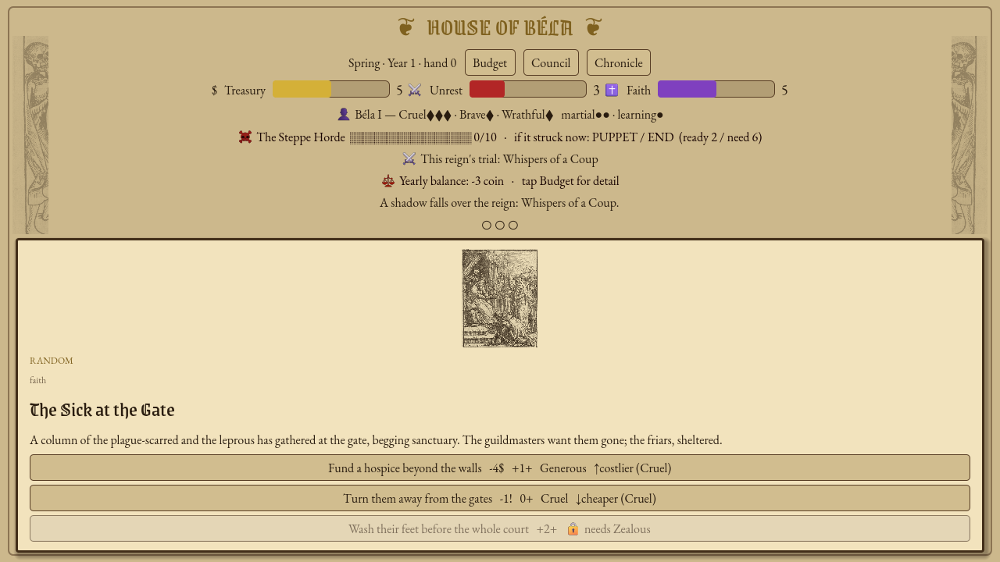
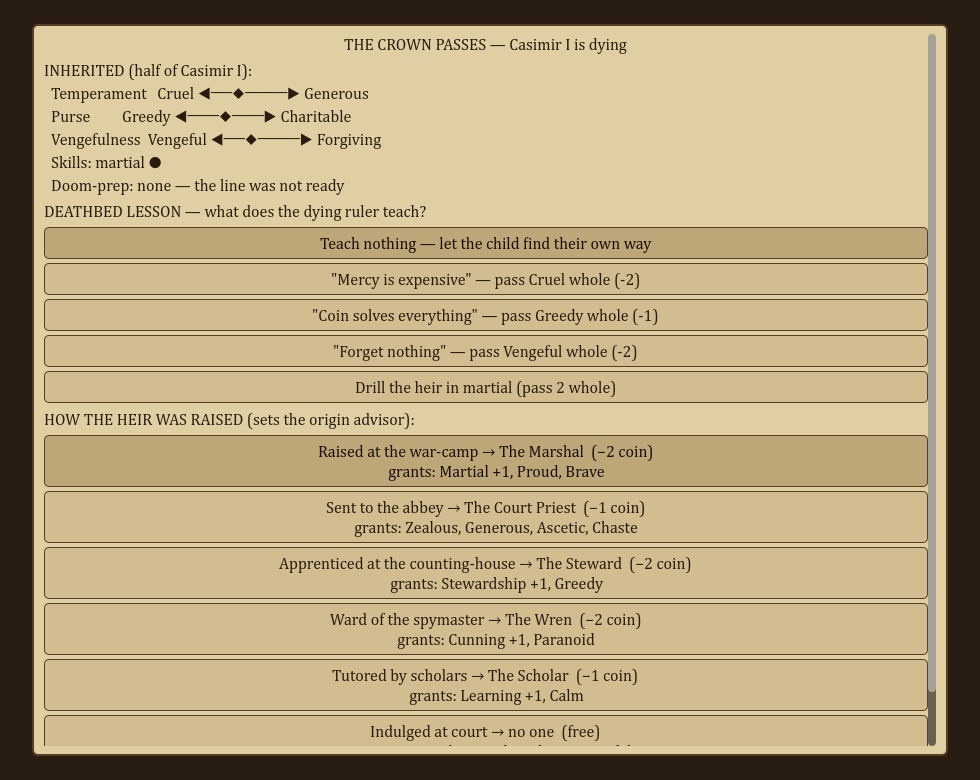

# Sins of the Father

A darkly satirical medieval dynasty roguelite, built in Godot 4 with GDScript.

You rule one reign at a time. Every choice is written into the dynasty's Chronicle, and the sins of each ruler raise the price their heirs pay when the bloodline's Doom arrives. The fantasy the game is built around: "my choices three reigns ago decided this."

**Status:** playable prototype. All planned milestones are built, and the mechanics and UI are covered by headless tests. Balance and feel are still being playtested.





## How it plays

- **A hand of three cards each season**: one seasonal, one plot, one random. Each choice moves three meters, Treasury, Unrest and Faith. Let one collapse and the reign ends in bankruptcy, revolt or deposition.
- **Consequences come back.** A choice can schedule a later event: rob the caravan now, and the mercenaries return a few hands later. 28 of the 101 events exist only as consequences.
- **The ruler has a character.** Choices nudge trait sliders (Cruel to Merciful, Greedy to Charitable and others) and skills. Traits and skills unlock or lock options on later cards.
- **The Council.** Advisors lend skills, cost upkeep and have loyalty. Neglect one and a betrayal event fires; dismiss one and the realm remembers.
- **Succession.** The heir inherits half of the parent's traits. A deathbed lesson and the heir's upbringing shape the rest.
- **The Doom.** A track rises across the whole dynasty. When the Reckoning comes, its severity includes the ancestral sins recorded in the Chronicle.
- **Around the core loop:** a threat in every reign that escalates if ignored, trade routes, institutions with passive effects, and a legacy that carries between dynasties.

## Content is data

All content lives in JSON under `data/`: 101 events with 275 choices, 3 dooms, 5 advisors, 6 upbringings, 5 threats, 3 trade routes and 3 institutions. Adding an event means adding an entry, not writing code:

```json
{
  "id": "snake_case_id",
  "slot": "seasonal | plot | random",
  "category": "court | economy | faith | war | folk",
  "season": "spring | summer | autumn | winter | any",
  "title": "...",
  "body": "one or two sentences",
  "choices": [
    {
      "text": "...",
      "effects": { "treasury": 0, "unrest": 0, "faith": 0 },
      "traits": { "temperament": 1 },
      "flags": [ { "id": "...", "event_id": "...", "in_hands": 4 } ],
      "doom_mod": 0,
      "requires": { }
    }
  ]
}
```

## How it was built: an agent workflow with gates

I designed the game (design document, locked constants, critical requirements) and wrote the rules that AI coding agents work under. The agents wrote most of the GDScript and event text; I own the design, the constraints, the review and the playtest decisions. The setup is in the repository, so it can be read and reused:

- **`CLAUDE.md` / `AGENTS.md`** hold the routing rules and the definition of done. A cheaper model implements well-specified work. Architecture, hard bugs and anything touching the locked constants go to a planner agent first.
- **The narrator agent** (`.claude/agents/narrator.md`) writes everything a player reads. It has read-only tools, so it cannot change the repository. It proposes complete events, text and mechanics together, because the mechanics are part of the joke: a choice like "Pardon it; it's a pig" only lands because it costs Faith. It works in two modes: brief (invent an event within given constraints) and polish (sharpen the voice of a draft without touching the numbers).
- **One rule for tone**, handed to the narrator on every call: the joke is always on power and its excuses, never on the people who suffer.
- **A validation gate before content lands.** The implementing session checks the narrator's output against the schema, the value ranges, id uniqueness and the wiring of `requires` and `flags` before anything is written to `data/events.json`.
- **A playtest gate after every engine change.** `/playtest` runs a headless auto-played dynasty that must reach the Reckoning or a lose condition without a parse or runtime error.
- **A reviewer agent** (`.claude/agents/gdscript-reviewer.md`) reads every non-trivial GDScript change before it is done.

The same agents are also defined for Codex under `.codex/`.

## Run it

1. Install **Godot 4.7** (standard build, not .NET).
2. In the Godot project manager choose **Import**, select `project.godot`, then **Open**.
3. Press **F5**. The game opens on the founder screen: name your ruler and your house.

To watch a whole dynasty play itself in the console:

```
godot --headless --path . Main.tscn
```

## Tests

Seven headless suites run from one script. Set the Godot and project paths at the top of `run-tests.ps1`, then:

```
powershell -ExecutionPolicy Bypass -File .\run-tests.ps1
```

```
[ContentDB] loaded 101 events, 3 dooms, 5 advisors, 6 upbringings, 5 threats, 3 routes, 3 institutions (28 consequence-only)
TestPlaystyles  [TEST] CR-16 PASS - mercy allies, cruelty pays; the paths diverge and both survive
TestThreats     [TEST] THREATS PASS - a threat every reign; duck it and it escalates into a crisis
TestTrade       [TEST] TRADE PASS - routes open, income flows, disruption bites, steward bonus capped
TestMeta        [TEST] META PASS - institutions grant passives; legacy carries works + boon across dynasties
TestTraits      [TEST] TRAITS PASS - new sliders + Learning move, gate, inherit, and mitigate
TestEscalation  [TEST] ESCALATION PASS - prep decays, severity climbs; no line is immortal
TestCardRender  [TEST] CARD RENDER PASS - 4/4 option buttons, title=true, preview=true
```

## Project layout

```
project.godot            autoloads are registered here
Main.tscn / Main.gd      headless auto-play driver used by /playtest
autoload/
  ContentDB.gd           loads the JSON content
  GameState.gd           meters, hand counter, upkeep, lose checks
  EventEngine.gd         deals the hand, resolves a choice, gates options
  Chronicle.gd           ledger of acts and the consequence queue
  Council.gd             advisors, loyalty, betrayal
  Succession.gd          inheritance, deathbed lesson, upbringing
  DoomManager.gd         doom track, preparation, severity, the Reckoning
  ThreatManager.gd       a threat for every reign
  TradeManager.gd        trade routes and income
  InstitutionManager.gd  institutions and their passive effects
  Legacy.gd              what carries over between dynasties
resources/Ruler.gd       trait sliders and skills
sim/                     auto-player and dynasty simulation
ui/                      screens, the event card, theme, art and fonts
data/                    all game content as JSON
tests/                   headless test scenes
tools/                   screenshot tool
.claude/  .codex/        agent definitions and commands
```

Logic lives in the autoloads; the UI only renders `GameState` and emits choices.

The design documents that `CLAUDE.md` refers to are not part of this repository.

## Credits and licenses

- **Card art:** plates from Hans Holbein's *Dance of Death* etched by Wenceslaus Hollar, and the Dance of Death woodcut from the Nuremberg Chronicle (1493). Public domain, taken from The Met Open Access collection (CC0), trimmed and recoloured.
- **Fonts:** EB Garamond and Grenze Gotisch under the SIL Open Font License. The license texts are in `ui/fonts/`.
- **Code and game text:** copyright 2026 Bekzat Kambar. No license has been chosen yet, so they are not licensed for reuse.
